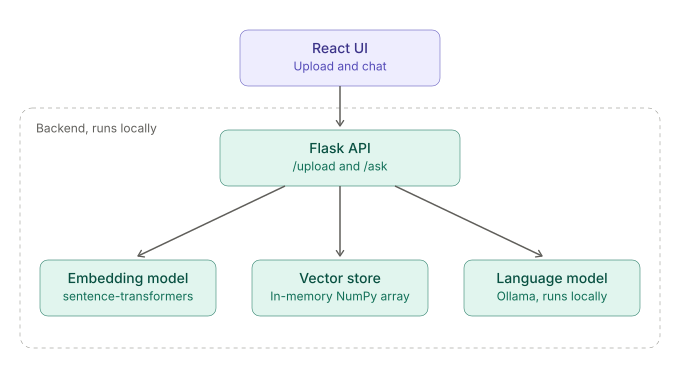
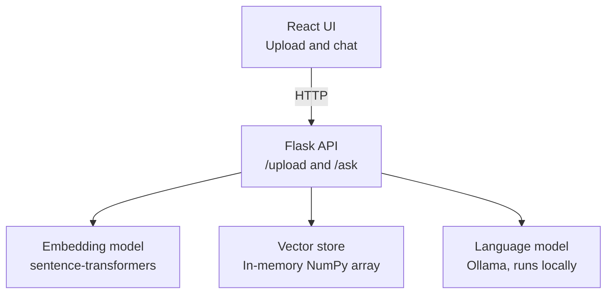
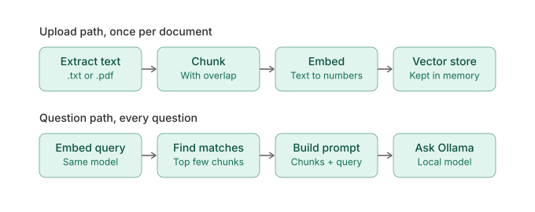
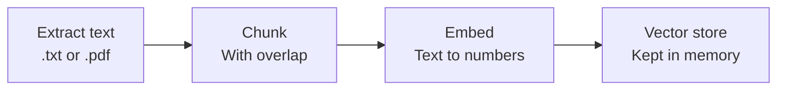
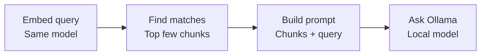
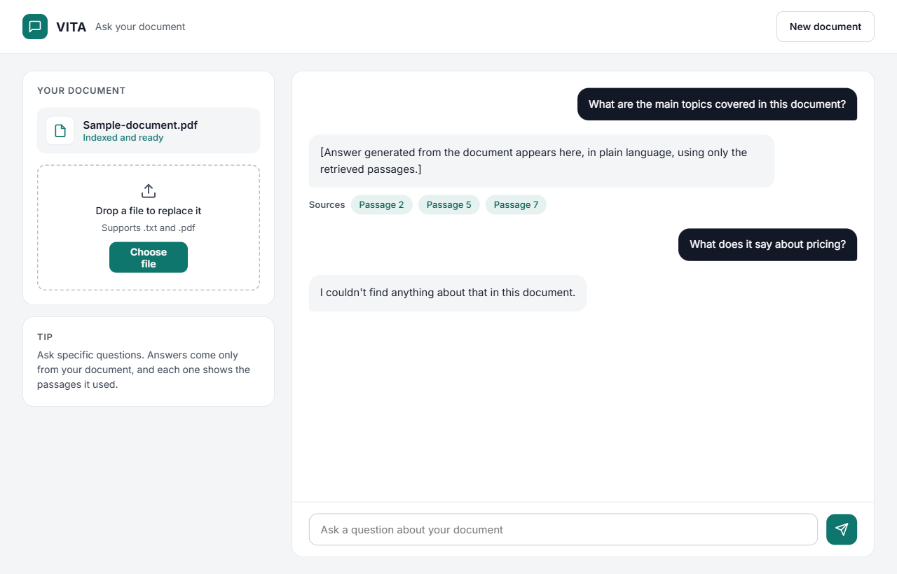

# VITA Document Chatbot

Upload a `.txt` or `.pdf` document, then ask questions about it in a simple chat.
Answers come only from the uploaded document, and every answer shows the passages it used.

The whole stack runs **locally and for free**: no paid API keys, and your documents never leave your machine.

---

## Table of contents

1. [How it works](#how-it-works)
2. [Tech stack](#tech-stack)
3. [Architecture](#architecture)
4. [Data flows](#data-flows)
5. [UI design](#ui-design)
6. [API specification](#api-specification)
7. [Project structure](#project-structure)
8. [Setup](#setup)
9. [Build roadmap](#build-roadmap)
10. [Known limitations](#known-limitations)
11. [Future improvements](#future-improvements)

---

## How it works

This project uses **RAG (Retrieval-Augmented Generation)**. A language model cannot read a whole document at once and does not know what is inside it, so we:

1. **Extract** the text from the uploaded file
2. **Chunk** it into small overlapping pieces
3. **Embed** each chunk (turn it into a vector of numbers that captures its meaning)
4. **Store** the vectors
5. When a question arrives, **embed the question** and find the most similar chunks
6. **Send those chunks plus the question** to the language model, telling it to answer only from that context

If the answer is not in the document, the bot should say so instead of guessing.

---

## Tech stack

| Layer | Choice | Why |
|---|---|---|
| Frontend | React | Upload button and chat UI |
| Backend | Python, Flask, Flask-CORS | Small API with two endpoints |
| PDF reading | `pypdf` | Extracts text from PDFs |
| Embeddings | `sentence-transformers` (`all-MiniLM-L6-v2`) | Free, runs locally, small download |
| Vector search | NumPy (cosine similarity) | No database needed for version 1 |
| Language model | Ollama (for example `llama3.2`) | Free, runs locally |

> Free hosted options such as the Gemini API free tier exist, but their limits change often and free-tier data may be used by the provider. Use only public or dummy documents with them, never confidential files.

---

## Architecture

The React UI talks only to the Flask API. Flask coordinates three local components: the embedding model, the vector store, and the language model.



The same diagram in Mermaid, as an editable text version (renders on GitHub):



### Components

| Component | Responsibility |
|---|---|
| React UI | File upload, message list, question input, shows source passages |
| Flask API | Receives uploads and questions, coordinates the pieces below |
| Embedding model | Turns chunks and questions into vectors |
| Vector store | Holds chunk text and vectors for each uploaded document, keyed by `doc_id` |
| Language model | Writes the final answer from the retrieved context |

---

## Data flows

There are two separate paths. The upload path runs once per document. The question path runs for every question.



The same flows as text diagrams:

### Upload path (once per document)



### Question path (every question)



### Two rules that matter

- **Use the same embedding model for chunks and questions.** Otherwise their vectors cannot be compared.
- **Retrieval is the quality gate.** If the wrong chunks come back, no prompt can save the answer. Test retrieval on its own, before connecting the language model.

### Pipeline functions

| Function | Job | How to test it alone |
|---|---|---|
| `extract_text(path)` | Read `.txt` or `.pdf` | Print the first 500 characters |
| `chunk_text(text, size, overlap)` | Split into overlapping pieces | Print the chunk count and look at 3 chunks |
| `build_index(chunks)` | Embed all chunks once | Check the array shape is (number of chunks, 384) |
| `retrieve(question, chunks, vectors, k)` | Return the top k chunks | Print them and ask whether a human could answer from them |
| `answer(question, context_chunks)` | Prompt Ollama with the context | Ask something the document does and does not cover |

### Prompt rule

Tell the model to answer using only the provided context, and to say it could not find the answer when the context does not contain it. Small local models can ignore instructions more often than large hosted ones, so tighten the prompt if needed.

---

## UI design

A single page with a document panel on the left and the chat on the right. On a phone-width screen the layout stacks vertically.



### Screen regions

| Region | Contents |
|---|---|
| Header | Logo mark, "VITA", the line "Ask your document", and a "New document" button |
| Left panel, "Your document" | Current file with a status line ("Indexed and ready"), a dashed drop zone ("Drop a file to replace it", "Supports .txt and .pdf") with a "Choose file" button |
| Left panel, "Tip" | One short hint: ask specific questions, answers come only from the document and show the passages used |
| Chat area | User messages right-aligned in dark bubbles, answers left-aligned in light bubbles |
| Sources row | Pill chips under each answer showing which passages were used |
| Fallback answer | "I couldn't find anything about that in this document." |
| Input bar | Text box and a send button |

### Visual style

| Token | Value |
|---|---|
| Page background | `#F3F5F7` |
| Surfaces | `#FFFFFF` with a `#E2E6EB` border, 16px radius |
| Primary text | `#121826` |
| Secondary text | `#4B5563` |
| Accent (buttons, status, send) | `#0F766E` |
| Source chips | `#E6F2F0` background, `#0B5A54` text |
| User bubble | `#121826` background, white text |
| Font | Inter |
| Minimum touch target | 44px |

Accessibility: real `<button>` and `<input>` elements, an `aria-label` on the icon-only send button, and a hidden `<label>` for the question box.

### Mapping the UI to the code

| UI element | What it does in React |
|---|---|
| Choose file / drop zone | Posts a `FormData` to `/upload`, stores the returned `doc_id`, flips the status to "Indexed and ready" |
| Message list | State array of `{ role, text, sources }` |
| Sources chips | Rendered from the chunk numbers returned by `/ask` |
| Fallback answer | Comes from the system prompt, not from the UI |
| Send button | Posts `{ doc_id, question }` to `/ask` and appends the reply |

> The image above is the mockup made on the Claude design canvas. Treat it as a target to build toward.

---

## API specification

### `POST /upload`

Accepts a multipart form with a `file` field (`.txt` or `.pdf`).

Success response:

```json
{ "doc_id": "uuid-string", "chunks": 42 }
```

Errors: `400` when no readable text is found (for example a scanned PDF).

### `POST /ask`

Request:

```json
{ "doc_id": "uuid-string", "question": "What is this document about?" }
```

Success response:

```json
{ "answer": "...", "sources": [2, 5, 7] }
```

Errors: `404` for an unknown `doc_id`.

> `sources` is a planned addition so the UI can render the Sources chips. Return the indexes of the retrieved chunks.

---

## Project structure

A suggested layout:

```
doc-chatbot/
  backend/
    app.py            Flask app, /upload and /ask
    pipeline.py       extract_text, chunk_text, build_index, retrieve, answer
    requirements.txt
  frontend/
    src/
      components/
        DocumentPanel.jsx
        ChatWindow.jsx
        MessageBubble.jsx
        SourceChips.jsx
      App.jsx
  images/             architecture-overview.svg, data-flows.svg, Chat with a document@1x.png
  README.md
```

---

## Setup

### Backend

```bash
mkdir doc-chatbot && cd doc-chatbot
python -m venv venv
source venv/bin/activate          # Windows: venv\Scripts\activate
pip install ollama sentence-transformers numpy pypdf flask flask-cors
```

The `sentence-transformers` install pulls in PyTorch, which is a large download.

### Local language model

1. Install Ollama from [ollama.com](https://ollama.com).
2. Pull a small model and check it works:

```bash
ollama pull llama3.2
ollama run llama3.2
```

Rough guide by memory: 8 GB RAM suits a 3B model such as `llama3.2`. With 16 GB or more you can try a 7 to 8B model, which gives better answers but runs slower on CPU.

### Run

```bash
python backend/app.py
```

Make sure Ollama is running first (the app runs in the background after install, or run `ollama serve`).

---

## Build roadmap

Build one milestone at a time and run it before moving on.

| # | Milestone | Done when |
|---|---|---|
| 1 | Talk to a local model | A Python script prints a reply from Ollama |
| 2 | Read documents | `extract_text` prints text for both `.txt` and `.pdf` |
| 3 | Chunking | You can see sensible chunks and compare chunk sizes of 200, 800 and 2000 characters |
| 4 | Embeddings | In the cat / kitten / stock-prices test, the first two sentences score high and the third scores low |
| 5 | Retrieval | The top chunks for a question are ones a human could answer from |
| 6 | Generate the answer | The bot answers from context and says so when the answer is missing |
| 7 | Flask API | `/upload` and `/ask` work from curl or Postman |
| 8 | React UI | Upload, chat, and source chips work end to end |

Tip: build and test a command-line version (load document, build index, ask questions in a loop) before adding Flask or React.

---

## Known limitations

- **Scanned PDFs** are images, so `pypdf` returns empty text. Show an error for now. OCR would be needed to support them.
- **In-memory storage** disappears when the server restarts.
- **No chat memory.** Each question is answered independently, so follow-ups like "what about the second point?" will not work yet.
- **Small local models** are slower and less reliable than hosted ones, especially on CPU.
- **Embedding the document once** at upload time is important. Do not re-embed on every question.

---

## Future improvements

- Return and display source passages with each answer
- Send recent messages along with the new question to support follow-ups
- Replace the in-memory store with Chroma, FAISS, or PostgreSQL with `pgvector`
- Add file size limits and clearer error handling
- Optionally swap in a hosted model for better answer quality. Ollama and Gemini both offer OpenAI-compatible endpoints, so keeping the model name, base URL and key in one config place makes switching easy
